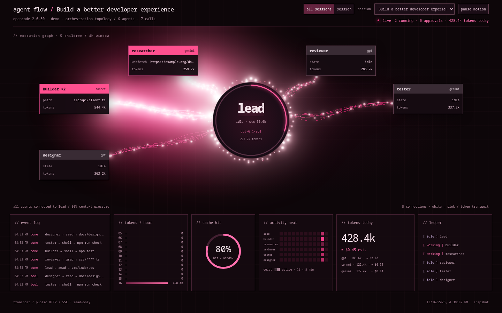

# opencode-agent-flow

A live, read-only visualization of OpenCode V2 orchestration. See agent trees,
grouped parallel calls, current tools, approval waits, token usage and estimated
costs in one WebGL dashboard. Connect to a local or remote OpenCode server using
only its public HTTP API and SSE—no database access required.

Zero runtime npm dependencies. Node.js 20+; no frontend build step.



## Quick start

```sh
npx opencode-agent-flow
# Protected server: supply the password through your environment, not CLI flags.
OPENCODE_SERVER_PASSWORD="$YOUR_OPENCODE_PASSWORD" npx opencode-agent-flow
# Remote server
OPENCODE_SERVER_PASSWORD="$YOUR_OPENCODE_PASSWORD" npx opencode-agent-flow --server https://opencode.example.org
# Fictional data, no server required
npx opencode-agent-flow --demo --open
```

Open <http://127.0.0.1:3340>. For an unpublished local checkout:
`node bin/cli.mjs --demo`.

## Options

| Flag | Environment fallback | Default |
| --- | --- | --- |
| `--server URL` | `OPENCODE_URL` | `http://127.0.0.1:4096` |
| `--username NAME` | `OPENCODE_SERVER_USERNAME` | `opencode` |
| `--port NUMBER` | `PORT` | `3340` |
| `--host ADDRESS` | — | `127.0.0.1` |
| `--allowed-host HOST` (repeatable) | — | Additional allowed hostname |
| `--window HOURS` | `WINDOW_HOURS` | `4` |
| `--open` | — | Open the browser |
| `--demo` | — | Built-in fictional data |
| `--help` | — | Show usage |

`OPENCODE_SERVER_PASSWORD` is accepted **only through the environment**. Without
it the BFF tries unauthenticated access; rejected access leaves the UI connecting
while the backend retries.

## How it works

A thin Node backend-for-frontend (BFF) loads paginated session/message history,
keeps one global upstream SSE subscription, and sends aggregated snapshots to
the browser. Reconnects use exponential backoff (1–30 seconds), reset only after
a connection lasts at least 30 seconds. Full resynchronization is limited to
once per 10 seconds; initial connection failures retry with the same backoff.
A periodic reconciliation (every 60 seconds) catches missed events. Permissions and forms are
polled for each active location. All/session modes, grouped `×N` agents and
individual-call popovers preserve the orchestration hierarchy.

`N agents · M calls` counts visible groups and all sessions respectively, each
including the root. The recent activity window applies to root selection; explicit
session mode loads the complete selected tree, including dormant children.

## Security and compatibility

- Loopback binding by default. **The UI has no authentication**; exposing it on
  another interface reveals session titles, paths and activity. Use an authenticated
  reverse proxy for shared deployments.
- The upstream password stays in Node, never in browser responses or URLs.
  Use HTTPS to protect Basic authentication to remote servers.
- Host/Origin checks reject unapproved hostnames (DNS-rebinding protection).
  Extra hostnames require `--allowed-host`; the configured port is enforced.
- The UI displays session titles, commands and paths. Secret redaction is
  **best-effort**, not a guarantee. Do not expose it to a network without a
  reverse proxy providing authentication. Report vulnerabilities via
  [GitHub Security Advisories](https://github.com/orybakov/opencode-agent-flow/security/advisories/new).
- Tested against **OpenCode 2.0.30** and a clean, isolated **2.0.32** installation
  (official V2 npm package: `@opencode/cli`, not the V1 `opencode-ai` package).
  On 2.0.32, `opencode serve` generates a password when none is configured;
  supply that password or set `OPENCODE_SERVER_PASSWORD` on both processes.
  The V2 HTTP API is **experimental**; future
  changes may require adapter updates. Non-V2 servers remain in connecting state.
- SSE is live-only, without replay. Reconciliation recovers durable snapshots,
  not every transient event. No historical permission-decision journal is available.
- Token/cost panels use available history (at least 12 hours/current day for
  default aggregates). Context size is approximate, not an exact provider meter.

## Cost estimates

`prices.json` supplies editable USD-per-million input/output/cache-read rates and
context limits. The UI labels costs **`≈ est.`**: pricing may be outdated, provider
subscriptions may differ, and these figures are not billing statements.

## Development

```sh
node bin/cli.mjs --demo
node --test
npm pack --dry-run
```

See [architecture](docs/architecture.md) and
[public API notes](docs/opencode-v2-api-notes.md). Vendored browser modules avoid
CDN/network dependencies; there is no install or bundling step.

## License and acknowledgements

MIT © 2026 orybakov. WebGL rendering uses [three.js](https://threejs.org/),
vendored under its MIT license in `public/vendor/three/LICENSE`.
